# Bratislavský hrad a Staré Mesto – 3D prechádzka, ktorú postavila AI

**▶ Živá ukážka v prehliadači:** https://lukaskraic.github.io/bratislava-castle-3d/
(WebGL 2. Hrad sa načíta hneď (~135 MB), Staré Mesto a nábrežie (~68 MB) sa dotiahnu na pozadí, ukazovateľ je dole na obrazovke.
Najlepšie v desktopovom Chrome, kliknutím do okna sa zachytí myš.)

> **TL;DR (EN):** A walkable first-person 3D model of Bratislava Castle, built autonomously by
> **Claude Code** in a single overnight session (~6 h, hard deadline). The model was given a one-line
> task, found and downloaded the data itself (OpenStreetMap, national LiDAR terrain, orthophotos,
> reference photos), wrote a procedural Blender generator and a Godot 4 walking game, tested walkability
> with an automated walk-through, and iterated on realism against real photos with help of
> code-review agents. A human only gave short nudges such as "too bright" or "look at the photos".
> Follow-up rounds (V2–V5, several more long autonomous sessions with parallel sub-agents) extended it into a walk from the castle
> down the stairs through Podhradie and the Old Town to the Danube, with faithful landmarks (SNP Bridge, St Martin's
> Cathedral, Michael's Gate, Old Town Hall, SND), CC0 cars and people, and Google Earth–matched verification shots.

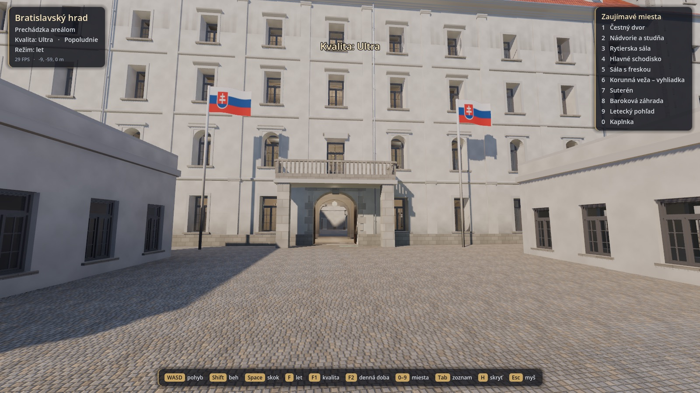

## Zadanie

Toto je ukážka toho, čo dokáže **Claude Code** (model Claude Opus 5.5), keď dostane voľnú ruku a limitovaný čas.
Celé zadanie znelo:

> *„chcem test vymodelovania bratislavského hradu čo najvernejšie, v blender, tak aby som sa vedel
> v ňom poprechádzať, povedz mi čo mám nainštalovať a dohľadaj si data, pracuj do 03:00, 3. 10. 2026"*

a neskôr *„úloha končí keď týždenný kredit, alebo v dohodnutom čase, inak vylepšuj, vylepšuj, vylepšuj,
môžeš si zavolať 3× codex na kontrolu kvality"*.

Nedostal **žiadne podklady**: ani pôdorysy, ani modely, ani fotky. Všetko si dohľadal, stiahol a spracoval sám.
Človek do práce zasahoval iba krátkymi pripomienkami, napríklad *„strašné, presvietené, nelogické veci,
dvere…"*, *„ak si budeš myslieť, že to máš dobré, pozri sa na fotky :-)"*, *„stále veľa svetla"*,
*„urob perfektne aj záhradu"*, *„väčšie detaily, stromy"* či *„vlajka by mohla viať vo vzduchu"*.

## Časová os

| Kedy | Čo |
|---|---|
| 2. 10. 19:55 | zadanie, kontrola prostredia, inštalácia Blendera (brew) |
| 20:00 – 20:30 | rešerš (subagent): rozmery paláca a veží, LiDAR, licencie; stiahnutie OSM, DMR 5.0 a ortofota ZBGIS |
| 20:30 – 21:30 | prvý generátor (palác, veže, interiér, terén, mesto) a Godot projekt (paralelný subagent) |
| 21:30 – 23:00 | spätná väzba „presvietené, nelogické": oprava svetiel, dvere, porovnávanie s fotkami z rovnakého uhla, záhrada z ortofota 5 cm/px |
| 23:00 – 02:10 | 8× Codex review a nezávislá vizuálna kontrola; suterén, Korunná veža, fresky, kaplnka, stromy z listových kariet, voda, obloha, noc |
| 3. 10. 02:10 | koniec v stanovenom čase (limit 03:00) |
| 5. 10. | web export, rozhranie s voľbou kvality, publikovanie na GitHub Pages |

**Čistý čas autonómnej práce:** približne 6 hodín. V priebehu práce bolo **8 kontrol kvality cez Codex**
a jedna nezávislá kontrola subagentom. Každá zmena bola overená automatickou prechádzkou s kolíziami
a sadou screenshotov z hry.

## Pokračovanie: z hradu do mesta (V2–V5)

| Kolo | Kedy | Zadanie (v skratke) | Výsledok |
|---|---|---|---|
| V2 | 16.–17. 10. | mesto, opevnenie, interiér, záhrada | Staré Mesto z OSM, brány a bašty, nové interiéry |
| V3 | 17. 10. 20:40 – 18. 10. 05:00 | *„chcem sa prejsť ako peší z hradu do Starého Mesta a k Dunaju"* | pešie trasy po OSM, 4 zostupy z hradu, nábrežie, 38 záberov z Google Earth na porovnanie |
| V4 | 18. 10. 11:20 – 19:05 | *„nesedia výšky… kvalita a reálnosť domov v Podhradí"* | domy sadnú na svah, schody a oporné múry, strechy, komíny, rampa mosta |
| V5 | 18. 10. 19:15 – 19. 10. 06:00 | *„spústa chýb… zábradlia, most začína vo vzduchu… pamiatky nech sú verné"* | systematický lov chýb (368 pohľadov do 4 strán, 20× Codex), verné pamiatky podľa fotiek, autá a ľudia |

Ako sa pracovalo: koordinátor rozdelil prácu medzi paralelných agentov (mesto, opevnenie, pamiatky, jadro hradu, web),
po každom kole spravil spoločný build, automatickú prechádzku a zábery z výšky očí každých 35 m po trasách do 4 strán.
Chyby hľadali nezávislí recenzenti (Codex, Fable) porovnaním s Google Earth a fotkami; každú opravu overil walktest.

- **Pamiatky podľa fotiek** (`scripts/v2_landmarks.py`): Most SNP (šikmý A-pylón, UFO, dve roviny lán, oceľová mostovka,
  lávky pod ňou), Dóm sv. Martina (veža s korunou vo výške 84,8 m, kaplnka s medenou kupolou), Michalská brána,
  Stará radnica, SND, Primaciálny palác, Reduta, Klarisky.
- **Mesto** (`scripts/v2_city.py`): budovy z OSM s fasádami, výkladmi, priechodmi a strechami, ulice, chodníky, prechody,
  lampy, lavičky, stromy, Dunaj a nábrežie, mosty a estakády.
- **Opevnenie a zostupy** (`scripts/v2_fortress.py`): brány, bašty, terasy, Zámocké schody, Beblavého, Mikulášska, Viedenská brána.
- **Autá a ľudia**: CC0 modely (Quaternius, KayKit) zapečené do statických póz (`scripts/prep_props.py`),
  v hre inštancované (`godot/scripts/street_life.gd`).
- **Web loader**: hrad v hlavnom balíku, mesto v samostatnom `city_0.pck`, ktorý sa sťahuje počas hrania
  (`godot/scripts/web_loader.gd`, `scripts/make_web.sh`).

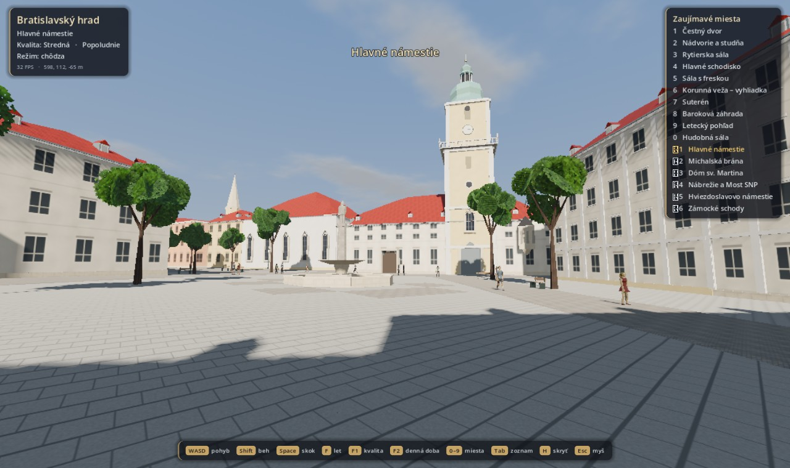

| | |
|---|---|
| 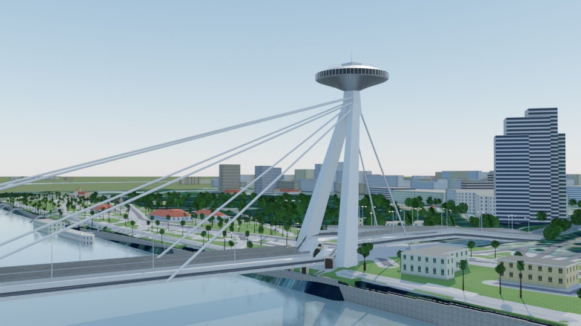 **Most SNP** s UFO | 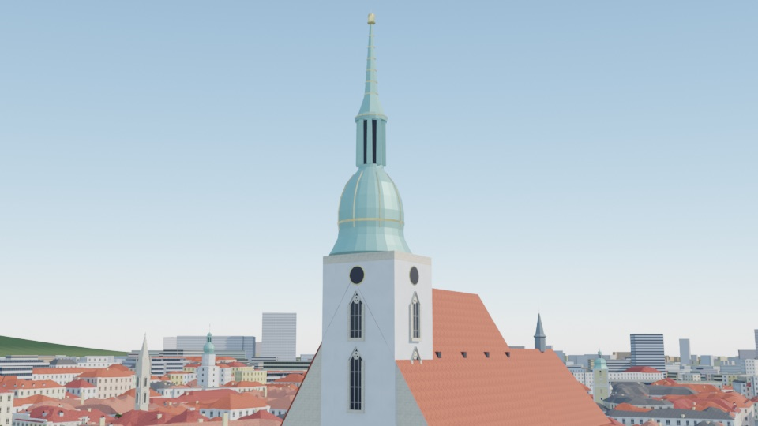 **Dóm sv. Martina**: veža s korunou |
| 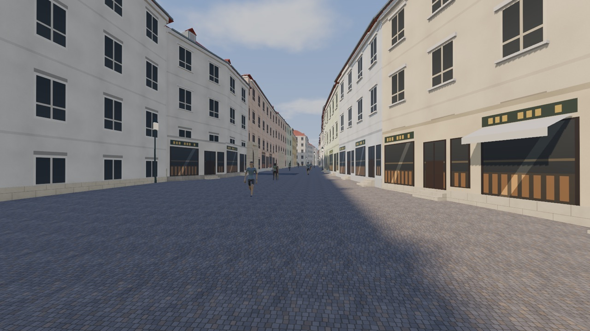 **Staré Mesto** z výšky očí | 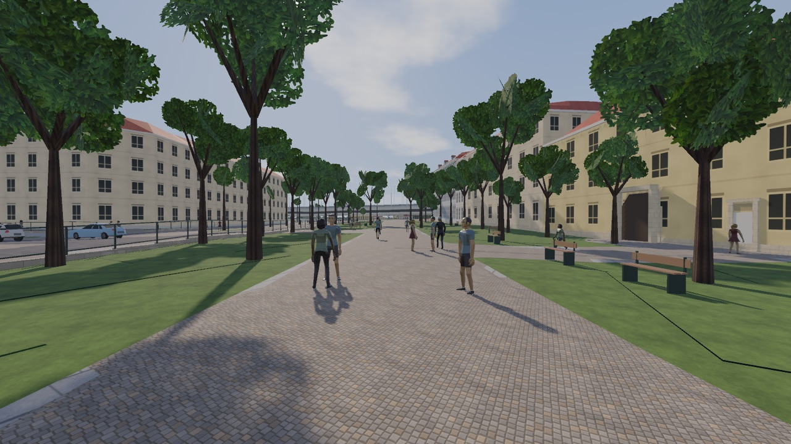 Hviezdoslavovo námestie s chodcami |

## Čo AI urobila sama (V1)

- **Dáta:**
  - OpenStreetMap (Overpass): pôdorysy, výšky, brány, hradby, schody, stromy, lavičky, lampy, fontány.
  - Výškový model **DMR 5.0 (LiDAR)**: vyčítaný bod po bode cez WMS GetFeatureInfo ÚGKK SR (mriežka 128 × 128 + okolie 3 × 3 km).
  - **Ortofoto ZBGIS** v troch mierkach. Z ortofota 5 cm/px je vystopovaný parter Barokovej záhrady
    (zimostrázové voluty, trávnik, tehlový štrk).
  - Referenčné fotky z Wikimedia Commons, podľa ktorých ladila proporcie (v repozitári nie sú).
- **Procedurálny generátor pre Blender** (`scripts/build_castle.py`, ~3 400 riadkov Pythonu):
  - palác so 4 vežami, skutočnými okennými otvormi, rímsami, vikiermi, žľabmi a strechou,
  - kompletný interiér s 5 podlažiami vrátane suterénu, schodísk a nábytku,
  - okolité budovy, hradby, schody, záhrada, stromy, Dunaj, Most SNP a Dóm sv. Martina.
- **Procedurálne textúry** v numpy (`scripts/textures.py`): omietka, škridla, žulové kocky, tehla, mramor, parkety, dub,
  listy, obrazy, freska, ku všetkým výškové a normálové mapy.
- **Godot 4 hra:**
  - pohyb v 1. osobe s kolíziami a krokovaním po schodoch,
  - denné doby vrátane noci, procedurálna obloha s mrakmi, animovaná voda a vlajky,
  - 4 stupne kvality a rýchly presun na zaujímavé miesta,
  - automatický test prechádzky, screenshoty a benchmark.

## Čo si pozrieť

| | |
|---|---|
| 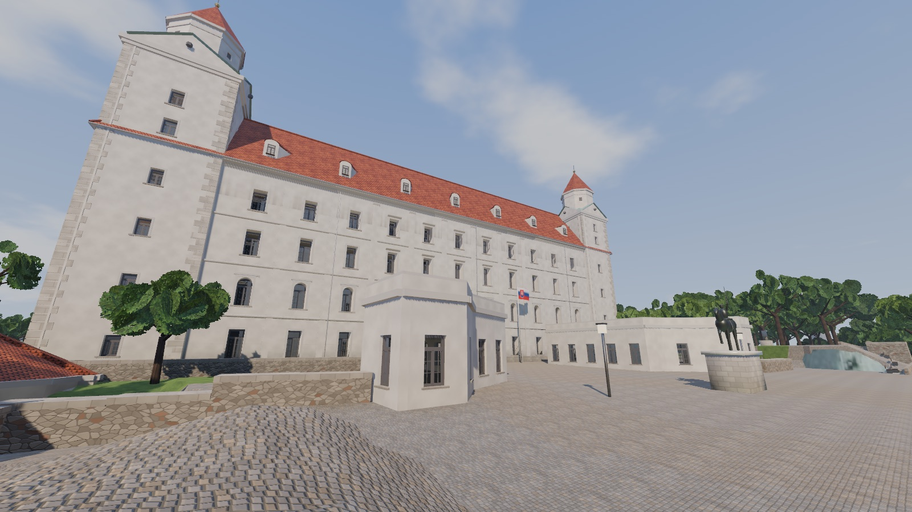 **Čestný dvor**: južná fasáda, Korunná veža, socha Svätopluka | 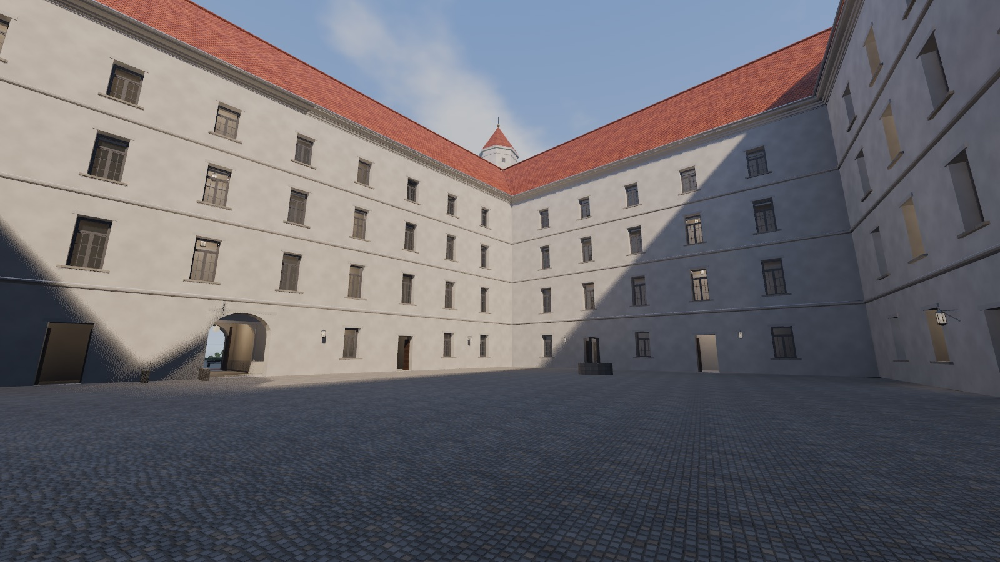 **Nádvorie** paláca so studňou na polohe z OSM |
| 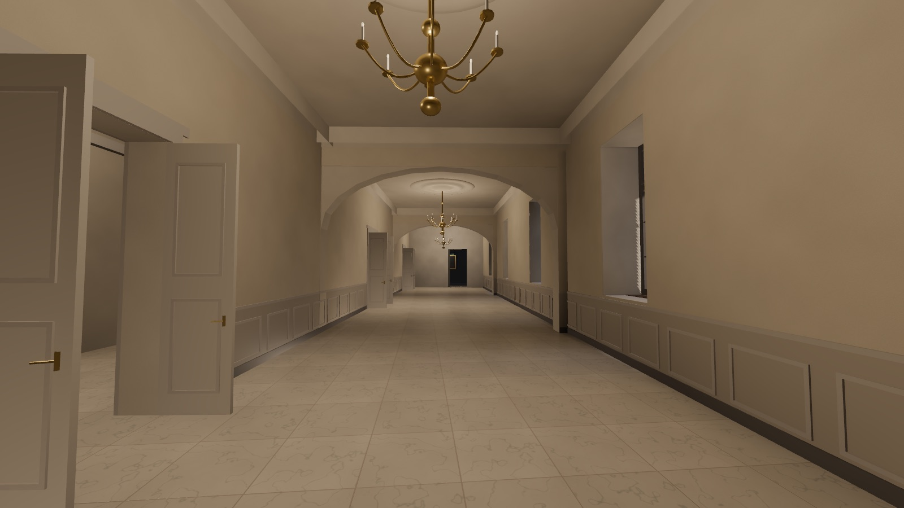 **Rytierska sála**: arkáda, mramor, lustre | 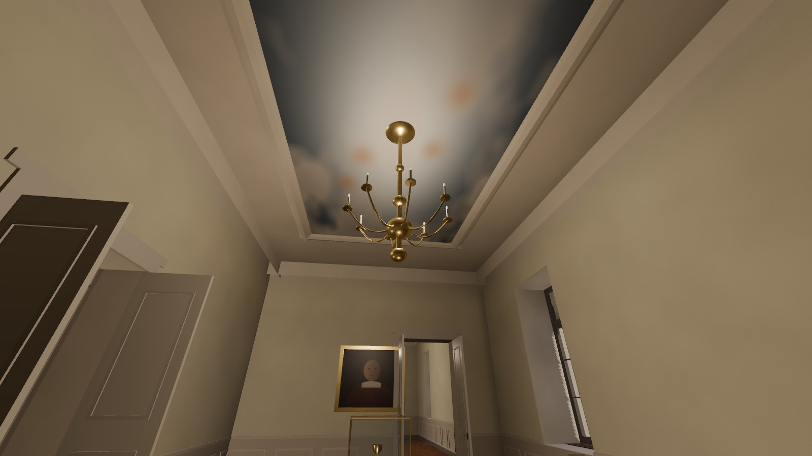 **Reprezentačná sála**: stropná freska, exponáty |
| 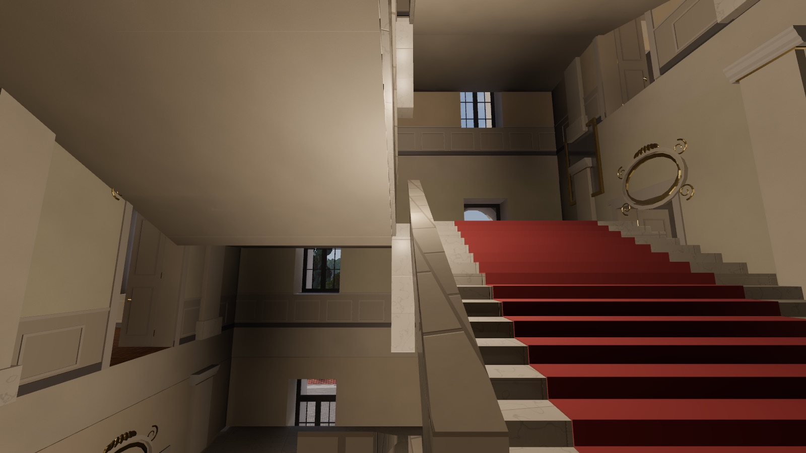 **Hlavné schodisko**: behúň, štuk, kartuše | 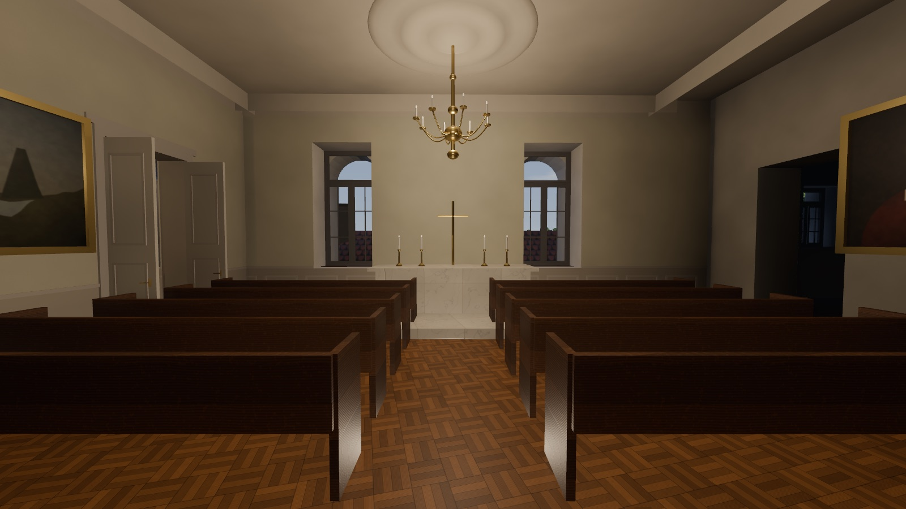 **Kaplnka** |
| 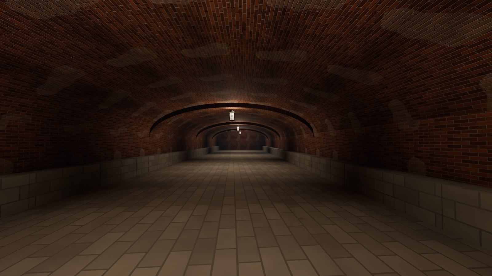 **Suterén**: tehlové klenby | 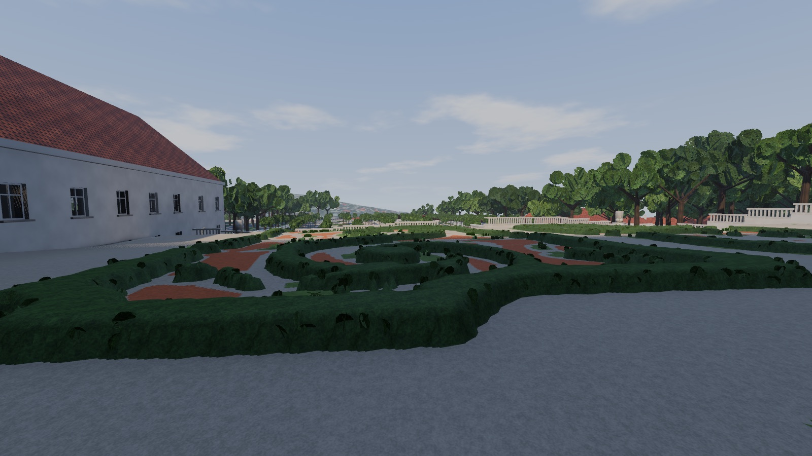 **Baroková záhrada**: parter z ortofota |
| 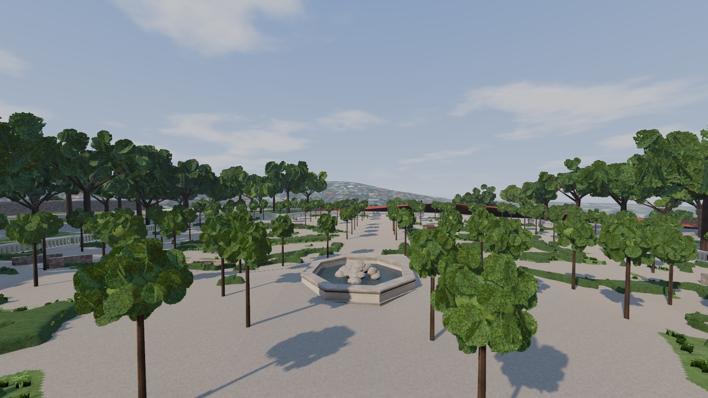 Strihané lipy a fontána | 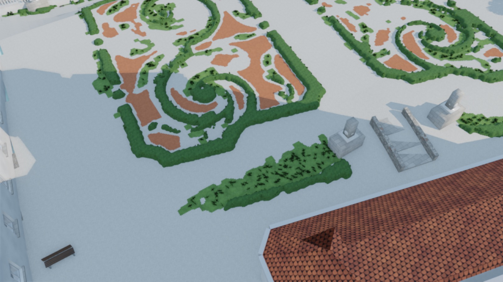 Brodériové záhony zhora |
| 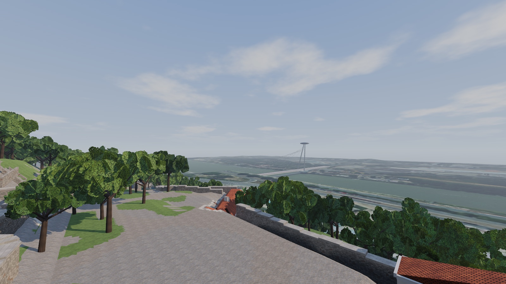 Výhľad na Dunaj, Most SNP a UFO | 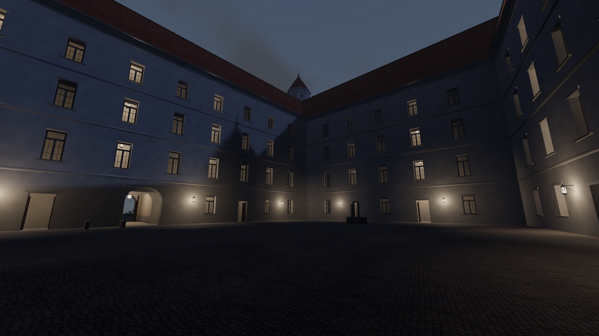 Noc na nádvorí |

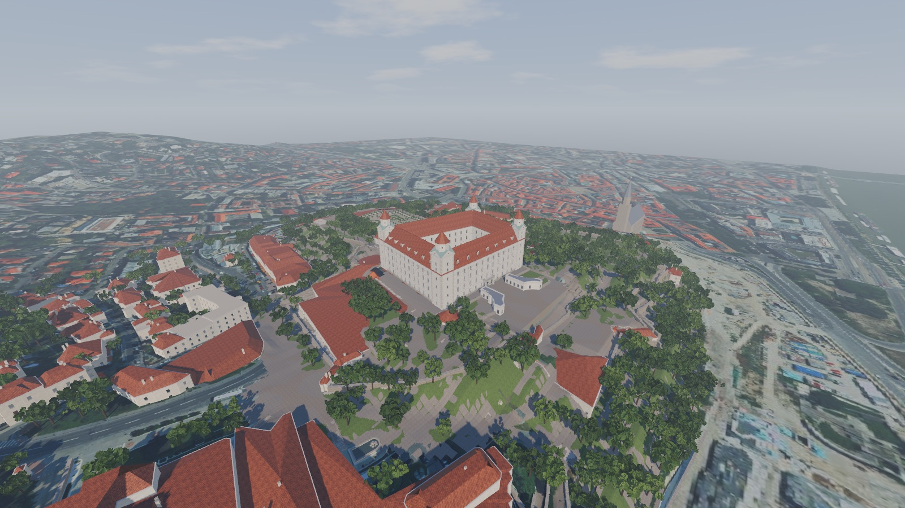

## Ovládanie

WASD pohyb, myš rozhliadanie, **Shift** beh, **Space** skok, **F** lietanie, **F1** kvalita (Nízka / Stredná /
Vysoká / Ultra), **F2** denná doba, **0–9** rýchly presun na zaujímavé miesta, **Tab** skryje/zobrazí zoznam miest (aktuálne miesto je zvýraznené),
**Shift+1–6** miesta v meste (Hlavné námestie, Michalská brána, Dóm, nábrežie a Most SNP, Hviezdoslavovo námestie,
Zámocké schody), **H** skryje rozhranie, **Esc** uvoľní myš.

Web verzia beží na renderi Compatibility (WebGL 2) a nemá globálne osvetlenie ani odrazy (SDFGI, SSR).
Plnú kvalitu poskytuje desktopová verzia.

## Spustenie lokálne (macOS)

```bash
brew install --cask blender godot
B=/Applications/Blender.app/Contents/MacOS/Blender
$B -b -P scripts/prep_props.py                                      # CC0 autá a ľudia -> godot/models/props
$B -b -P scripts/build_castle.py -- --tag main --hires              # ~5 min -> out/main/castle.glb (~2,7 mil. polygónov)
./import_model.sh out/main/castle.glb && ./run_godot.sh             # desktop (Forward+)
$B -b -P scripts/build_castle.py -- --web --tag web --split && scripts/make_web.sh   # web -> build/web
```

Testy (`godot --path godot -- …`): `--walktest` (hrad, interiér, záhrada, 4 zostupy z hradu, Dóm → Hlavné námestie
→ Michalská, Dóm → nábrežie, hrad → Dunaj), `--sighttest`, `--shots <dir>`, `--routeshots <dir> [--around]`
(zábery z výšky očí po trasách), `--earthshots <dir>` (kamery zhodné so zábermi z Google Earth), `--bench`.
Na Windows `SETUP_WINDOWS.md` a skripty `*.cmd` / `win/`.

## Čo je podľa dát a čo je odhad

- **Podľa dát:**
  - pôdorys paláca a nádvoria, okolité budovy, hradby, schody, brány,
  - terén,
  - polohy stromov, lavíc, lámp, sôch, studne a fontán,
  - parter záhrady.
- **Podľa fotiek:** proporcie veží (~45 m), okná, rímsy, vikiere, farby, Čestný dvor, pavilóny, balkón, socha.
- **Rekonštrukcia:** celý interiér, pretože verejné pôdorysy neexistujú. AI ho navrhla ako typickú barokovú dispozíciu
  a doplnila o známe miestnosti: Rytierska sála, Tereziánske schodisko, klenotnica v Korunnej veži, kaplnka, suterén.
- **Známe slabiny:**
  - obrazy a fresky sú zjednodušené, schodisko je generické,
  - fasády mesta sú procedurálne (bez zapustených okien), domy sa navzájom podobajú,
  - okraje dlažby a trávnika sú miestami zúbkované, na niekoľkých spojoch ciest sú malé schody,
  - autá a ľudia sú nízkopolygónové a stoja na mieste,
  - Vydrica je modelovaná ako dokončená (na Google Earth je stavenisko).

## Zdroje a licencie

- © prispievatelia **OpenStreetMap**, ODbL
- **ÚGKK SR / ZBGIS**: Ortofotomozaika SR, DMR 5.0 (otvorené údaje)
- Referenčné fotky z Wikimedia Commons a zábery z Google Earth slúžili len na porovnanie a nie sú súčasťou repozitára.
- Autá a ľudia: CC0 1.0 – Quaternius (quaternius.com), Kay Lousberg / KayKit (`data/assets/cc0/LICENSE.md`).
- Kód: MIT
